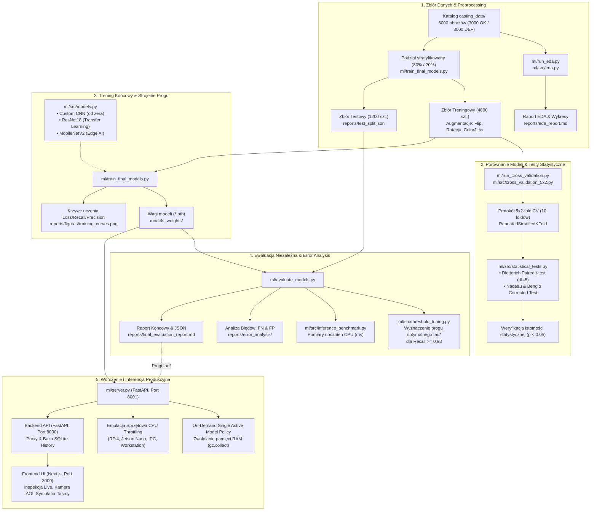

# Przewodnik po Kodzie Uczenia Maszynowego (ML Codebase Guide)
## System Automatycznej Kontroli Jakości Odlewów Wirników Pomp

Autorzy: Dawid Chudzicki (272715), Piotr Szczerbiak (294722)

---

## 1. Cel Inżynierski i Specyfikacja Zadania

Moduł Machine Learning odpowiada za automatyczną, bezstykową klasyfikację wizyjną odlewów wirników pomp zatapialnych na podstawie zdjęć o wysokiej rozdzielczości ($300 \times 300$ px). 

### Założenia biznesowe i kryteria jakościowe:
1. **Klasyfikacja binarna:**
   - Etykieta `0` (`ok_front`): Odlew poprawny (brak wad).
   - Etykieta `1` (`def_front`): Odlew wadliwy (wady odlewnicze: pęknięcia, pory, niedolewy, pęcherze gazowe).
2. **Kryterium krytyczne Zero-Defect (Bezpieczeństwo Produktu):**
   - **$\text{Recall} \ge 0.98$ (Czułość $\ge 98\%$):** Bezwzględny priorytet. Żaden wadliwy odlew nie może opuścić linii i trafić do montażu pompy (minimalizacja błędu *False Negative* - FN).
3. **Kryterium efektywności ekonomicznej:**
   - **$\text{Precision} \ge 0.90$ (Precyzja $\ge 90\%$):** Ograniczenie fałszywych alarmów (*False Positive* - FP), aby nie odrzucać sprawnych odlewów i nie generować strat produkcyjnych.
4. **Kryterium czasu rzeczywistego (Inline Inspection):**
   - **Czas inferencji $\le 100\text{ ms}$ na procesorze CPU** (wymóg synchronizacji z posuwem taśmy przenośnika).

---

## 2. Globalny Przepływ Danych i Potok ML (Flowchart)



---

## 3. Szczegółowy Opis Plików i Modułów Projektu

```
ml/
├── src/                          # Biblioteka algorytmiczna i narzędziowa
│   ├── dataset.py                # Loader danych, augmentacje i normalizacja
│   ├── models.py                 # Definicje architektur sieci (PyTorch)
│   ├── train_eval.py             # Pętla treningowa, walidacyjna i metryki
│   ├── threshold_tuning.py       # Strojenie progu decyzyjnego (Precision-Recall)
│   ├── cross_validation_5x2.py   # Procedura 5x2-fold Cross-Validation
│   ├── statistical_tests.py      # Testy t-Studenta Diettericha i Nadeau-Bengio
│   ├── inference_benchmark.py    # Pomiar czasu inferencji i zużycia pamięci
│   └── eda.py                    # Algorytmy analizy eksploracyjnej i integralności
├── run_eda.py                    # Punkt wejścia: Eksploracja danych i raport EDA
├── run_cross_validation.py       # Punkt wejścia: 5x2 CV i weryfikacja hipotez
├── train_final_models.py         # Punkt wejścia: Trening produkcyjny 3 modeli
├── evaluate_models.py            # Punkt wejścia: Ewaluacja na 1200 próbkach testowych
├── server.py                     # Mikroserwis produkcyjny FastAPI (kontener ML)
├── app.py                        # Pomocniczy dashboard analityczny Streamlit
├── Dockerfile                    # Środowisko kontenerowe PyTorch + FastAPI
├── requirements.txt              # Zależności biblioteczne Pythona
├── casting_data/                 # Zbiór 6000 obrazów (ok_front, def_front)
├── models_weights/               # Zapisane wagi (.pth) wytrenowanych modeli
└── reports/                      # Wygenerowane raporty, wykresy i analiza błędów
```

---

### A. Moduły Rdzenne w `ml/src/`

#### 1. [dataset.py](file:///home/dawid-chudzicki/projects/uczenie-maszyn/ml/src/dataset.py)
* Odpowiada za wczytywanie i przygotowywanie danych wejściowych dla sieci neuronowych.
* `CLASS_TO_IDX`: Mapowanie etykiet `ok_front: 0`, `def_front: 1`.
* `get_train_transforms()`: Augmentacje treningowe: `RandomHorizontalFlip`, `RandomVerticalFlip`, `RandomRotation(15)`, `ColorJitter(0.1, 0.1)`, normalizacja ImageNet ($\mu=[0.485, 0.456, 0.406]$, $\sigma=[0.229, 0.224, 0.225]$).
* `get_eval_transforms()`: Deterministyczny potok dla walidacji, testu oraz inferencji ($300\times 300$, ToTensor, Normalize).
* Klasa `CastingDataset(Dataset)`: Własny dataset PyTorch wymuszający 3 kanały RGB.

#### 2. [models.py](file:///home/dawid-chudzicki/projects/uczenie-maszyn/ml/src/models.py)
* Zawiera definicje 3 architektur sieciowych:
  1. **`CustomCNN`**: 4 bloki splotowe (Conv2d $3\to 32 \to 64 \to 128 \to 256$, BatchNorm, ReLU, MaxPool2d), `AdaptiveAvgPool2d((1, 1))`, Dropout(0.3), Linear(256, 128), BatchNorm1d, Linear(128, 1). 422 177 parametrów (~1.6 MB).
  2. **`build_resnet18()`**: Transfer learning z wag ImageNet. Podmieniona warstwa `fc` z Dropout(0.3) + Linear(512, 1). 11 177 025 parametrów (~42.7 MB).
  3. **`build_mobilenet_v2()`**: Lekka sieć z blokami Inverted Residuals. Podmieniona głowica `classifier[1]` z Dropout(0.3) + Linear(1280, 1). 2 225 153 parametrów (~8.6 MB).
* Funkcja `build_model(model_name)`: Wzorzec fabryki inicjalizujący model na wybranym urządzeniu (`cpu` / `cuda`).

#### 3. [train_eval.py](file:///home/dawid-chudzicki/projects/uczenie-maszyn/ml/src/train_eval.py)
* `compute_metrics(y_true, y_prob, threshold)`: Wylicza Recall, Precision, F1-Score, Accuracy, Specificity, ROC-AUC, PR-AUC oraz macierz pomyłek ($TP, FP, TN, FN$).
* `train_one_epoch()`: Pojedyncza epoka z obsługą mieszanej precyzji (`torch.amp.GradScaler`).
* `train_model()`: Pełna pętla treningowa z checkpointingiem najlepszych wag.
* Funkcja straty: `BCEWithLogitsLoss()`.

#### 4. [threshold_tuning.py](file:///home/dawid-chudzicki/projects/uczenie-maszyn/ml/src/threshold_tuning.py)
* Wyszukiwanie optymalnego progu decyzyjnego $\tau^*$ w celu spełnienia kryteriów przemysłowych.
* Przeszukuje 200 progów $\tau \in [0.01, 0.99]$.
* Filtruje te, dla których $\text{Recall} \ge 0.98$, i wybiera ten, który maksymalizuje $\text{Precision}$ oraz miarę $F_2$-score.
* Generuje wykresy krzywych decyzyjnych [reports/figures/threshold_tuning_*.png](file:///home/dawid-chudzicki/projects/uczenie-maszyn/ml/reports/figures/).

#### 5. [cross_validation_5x2.py](file:///home/dawid-chudzicki/projects/uczenie-maszyn/ml/src/cross_validation_5x2.py) & [statistical_tests.py](file:///home/dawid-chudzicki/projects/uczenie-maszyn/ml/src/statistical_tests.py)
* Rygorystyczny protokół 5x2-fold CV (5 powtórzeń 2-krotnego podziału = 10 foldów).
* Każdy fold trenowany na 50% danych i testowany na pozostałych 50%.
* `dietterich_5x2cv_paired_t_test()`: Statystyka $t$ z rozkładu $t$-Studenta ($df=5$) eliminująca błąd I rodzaju (zawodne orzekanie o wyższości modelu).
* `nadeau_bengio_corrected_t_test()`: Korekta wariancji dla powtarzalnych podziałów.

#### 6. [inference_benchmark.py](file:///home/dawid-chudzicki/projects/uczenie-maszyn/ml/src/inference_benchmark.py)
* Dokładny pomiar czasu inferencji pojedynczego obrazu ($batch=1$).
* Warm-up: 20 iteracji. Pomiar: 100 iteracji.
* Raportuje średnią, medianę, $P_{95}$, odchylenie standardowe oraz throughput (FPS).

#### 7. [eda.py](file:///home/dawid-chudzicki/projects/uczenie-maszyn/ml/src/eda.py)
* Weryfikacja integralności plików, balansu klas (3000/3000), wykrywanie duplikatów MD5 i percepcyjnych dHash.

---

### B. Główne Skrypty CLI

1. **[run_eda.py](file:///home/dawid-chudzicki/projects/uczenie-maszyn/ml/run_eda.py)**: Generuje raport EDA [reports/eda_report.md](file:///home/dawid-chudzicki/projects/uczenie-maszyn/ml/reports/eda_report.md).
2. **[run_cross_validation.py](file:///home/dawid-chudzicki/projects/uczenie-maszyn/ml/run_cross_validation.py)**: Uruchamia procedurę 5x2 CV oraz testy Diettericha dla wszystkich modeli.
3. **[train_final_models.py](file:///home/dawid-chudzicki/projects/uczenie-maszyn/ml/train_final_models.py)**: Generuje odizolowany zbiór testowy 1200 sztuk ([reports/test_split.json](file:///home/dawid-chudzicki/projects/uczenie-maszyn/ml/reports/test_split.json)), trenuje produkcyjne modele na 4800 obrazach i zapisuje wagi `.pth`.
4. **[evaluate_models.py](file:///home/dawid-chudzicki/projects/uczenie-maszyn/ml/evaluate_models.py)**: Ewaluuje modele na 1200 próbkach testowych, stroi progi decyzyjne $\tau^*$, wykonuje analizę błędów FN/FP w [reports/error_analysis/](file:///home/dawid-chudzicki/projects/uczenie-maszyn/ml/reports/error_analysis/) i generuje [reports/final_evaluation_report.md](file:///home/dawid-chudzicki/projects/uczenie-maszyn/ml/reports/final_evaluation_report.md).

---

### C. Mikroserwis Produkcyjny: [server.py](file:///home/dawid-chudzicki/projects/uczenie-maszyn/ml/server.py)

Działa jako samodzielny kontener Docker (`casting_ml_service`) na porcie 8001.

* **On-Demand Single Active Model Policy:** W pamięci RAM znajduje się zawsze maksymalnie jeden aktywny model. Odładowanie nieużywanych modeli i `gc.collect()` utrzymuje proces na poziomie <450 MB RAM.
* **CPU Throttling & Hardware Profiles:** Pozwala testować zachowanie taśmy na profilach sprzętowych: Pełna moc, IPC Intel Core i3, Jetson Nano, Raspberry Pi 4, Ultra Low-Power MCU.
* **Kluczowe Endpoints:**
  - `POST /predict`: Główna inferencja obrazu wirnika (werdykt OK/DEF, prawdopodobieństwo, latencja, status Zero-Defect).
  - `POST /simulation/step`: Zwraca kolejny odlew z puli 1200 próbek testowych w formacie Base64 z etykietą Ground Truth do automatycznej oceny taśmy na żywo.
  - `GET /samples/{category}/{filename}`: Serwuje pliki graficzne próbek wzorcowych.
  - `POST /system/cpu-throttle`: Zmiana profilu obciążenia CPU.

---

## 4. Porównanie Wyników Modeli na Zbiorze Testowym (1200 Próbek)

| Cecha / Metryka | Cel Inżynierski | Custom CNN | ResNet18 | MobileNetV2 |
| :--- | :---: | :---: | :---: | :---: |
| **Recall (Wykrywanie Wad)** | **$\ge 0.98$** | **1.0000** | **1.0000** | **1.0000** |
| **Precision (Brak Fałsz. Alarmów)** | **$\ge 0.90$** | 0.9772 | **0.9950** | 0.9820 |
| **F1-Score** | - | 0.9885 | **0.9975** | 0.9909 |
| **Dokładność (Accuracy)** | - | 0.9883 | **0.9975** | 0.9908 |
| **ROC-AUC** | - | 0.9999 | **1.0000** | **1.0000** |
| **PR-AUC** | - | 0.9999 | **1.0000** | **1.0000** |
| **Czas inferencji CPU** | **$\le 100\text{ ms}$** | **34.45 ms** | 62.52 ms | 59.22 ms |
| **Rozmiar wag na dysku** | - | **1.62 MB** | 42.67 MB | 8.62 MB |
| **Liczba parametrów** | - | **422 tys.** | 11.18 mln | 2.23 mln |
| **Optymalny próg $\tau^*$** | - | 0.158 | 0.197 | 0.099 |
| **Wady przeoczone (FN)** | **0** | **0** | **0** | **0** |
| **Fałszywe alarmy (FP)** | minimalna | 14 / 600 | **3 / 600** | 11 / 600 |
